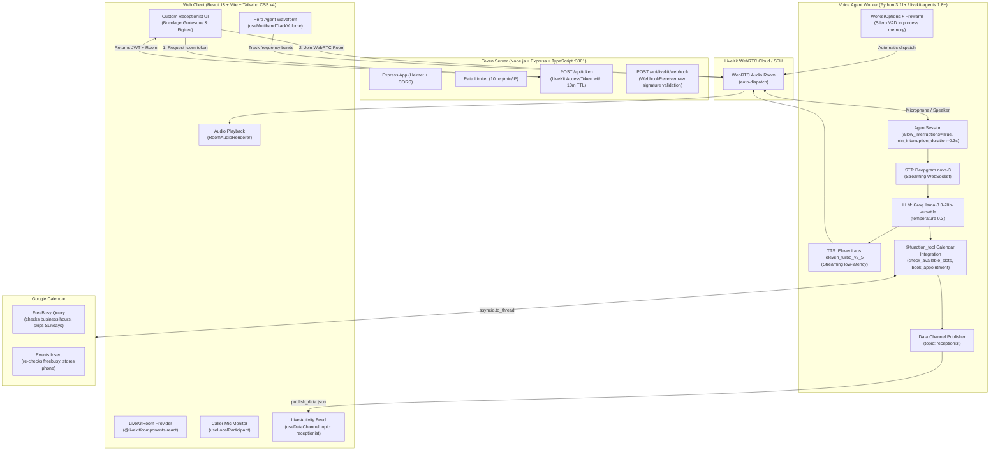

# 🏥 Voice AI Receptionist for Healthcare Clinics

A production-grade, real-time Voice AI Receptionist web application built for healthcare and medical clinics. A visitor clicks **Start call** in their browser and converses naturally with an AI receptionist. The assistant speaks warmly, answers inquiries, checks real-time slot availability on Google Calendar, and books appointments with sub-1.2 second time-to-first-audio latency and instantaneous barge-in interruption.

---

## 🏗️ Architecture Diagram



---

## ⚡ Key Highlights & Target Metrics

- **Time-to-First-Audio (TTFA):** Target under 1.2 s from end-of-user-speech to assistant voice playback.
- **Natural Barge-In Interruption:** When the caller interrupts, the agent detects user speech within 300 ms, halts TTS, and cancels the in-flight reply immediately. Emits an `interrupted` event to visually flag the badge and live activity log.
- **Prevent Double-Booking:** The agent re-checks Google Calendar `freebusy` immediately prior to `events.insert`.
- **Privacy & Domain Restrictions:** Service accounts store patient phone numbers in the event description rather than inviting attendees (avoiding Google Workspace domain delegation errors).
- **Custom Design System:** Light cool-grey foundation, deep medical teal brand primary, amber barge-in badge, and live activity timeline using Google Fonts **Bricolage Grotesque** and **Figtree**.

---

## 📋 Prerequisites

1. **Node.js**: v18.0.0 or later (v20+ recommended)
2. **npm** or **pnpm**
3. **Python**: Python 3.11, 3.12, or 3.13
4. **LiveKit Cloud Project**: (free tier available at [cloud.livekit.io](https://cloud.livekit.io))
5. **AI Provider Accounts**:
   - [Deepgram](https://console.deepgram.com/) for Nova-3 STT
   - [GroqCloud](https://console.groq.com/) for Llama-3.3-70B
   - [ElevenLabs](https://elevenlabs.io/) for Eleven Turbo v2.5 TTS
6. **Google Cloud Project** with Google Calendar API enabled and a Service Account key

---

## 🔑 Obtaining Required Credentials

### 1. LiveKit Credentials
1. Go to [LiveKit Cloud](https://cloud.livekit.io/) and create a project.
2. In **Project Settings** > **Keys**, copy your:
   - `LIVEKIT_URL` (starts with `wss://...`)
   - `LIVEKIT_API_KEY`
   - `LIVEKIT_API_SECRET`

### 2. Deepgram API Key
1. Go to [Deepgram Console](https://console.deepgram.com/).
2. Create an API key with member access and copy the key into `DEEPGRAM_API_KEY`.

### 3. Groq API Key
1. Go to [Groq Console](https://console.groq.com/keys).
2. Generate an API Key (starts with `gsk_...`) and copy it into `GROQ_API_KEY`.

### 4. ElevenLabs API Key
1. Sign in to [ElevenLabs](https://elevenlabs.io/).
2. Go to **Profile** > **API Keys** and generate a key.
3. Copy it into `ELEVENLABS_API_KEY`.
4. *(Optional)* Select a voice (e.g. `hpp4J3VqNfWAUOO0d1Us` or another voice ID) and set `ELEVENLABS_VOICE_ID`.

### 5. Google Calendar Service Account Setup
1. In the [Google Cloud Console](https://console.cloud.google.com/):
   - Create a new project (e.g., `clinic-receptionist`).
   - Navigate to **APIs & Services** > **Library** and search for **Google Calendar API**. Click **Enable**.
   - Navigate to **APIs & Services** > **Credentials** > **Create Credentials** > **Service Account**.
   - Fill in service account details (e.g., `clinic-bot`) and click **Done**.
2. Generate Service Account Key:
   - Click on the created service account email.
   - Go to the **Keys** tab > **Add Key** > **Create new key** > **JSON**.
   - Save the downloaded JSON file to your project directory (e.g., as `service-account.json`).
3. **CRITICAL STEP - Share Calendar with the Service Account:**
   - Open [Google Calendar](https://calendar.google.com/).
   - In the left sidebar, locate your clinic calendar (or primary calendar).
   - Click the three dots next to the calendar > **Settings and sharing**.
   - Scroll down to **Share with specific people or groups** and click **Add people and groups**.
   - Paste your service account email (e.g., `clinic-bot@your-project.iam.gserviceaccount.com`).
   - Under **Permissions**, choose **"Make changes to events"** (mandatory so the bot can write appointments).
   - Click **Send**.
4. In your `.env`:
   - Set `GOOGLE_CALENDAR_CREDENTIALS=./service-account.json` (or paste the JSON as a single-line string).
   - Set `GOOGLE_CALENDAR_ID` (either `primary` or your calendar's ID from the calendar settings page).

---

## ⚙️ Environment Configuration

Copy `.env.example` to `.env` in the repository root:

```bash
cp .env.example .env
```

Edit `.env` with your real keys:

```env
# LiveKit WebRTC Cloud
LIVEKIT_URL=wss://your-project.livekit.cloud
LIVEKIT_API_KEY=APIxxxxxxxxx
LIVEKIT_API_SECRET=secretxxxxxxxxxxxxxxxxxxxxxxxxxxxxxx

# AI Providers
DEEPGRAM_API_KEY=your_deepgram_api_key
GROQ_API_KEY=gsk_your_groq_api_key
ELEVENLABS_API_KEY=your_elevenlabs_api_key

# Google Calendar Integration
GOOGLE_CALENDAR_CREDENTIALS=./service-account.json
GOOGLE_CALENDAR_ID=primary

# Clinic / Business Configuration
BUSINESS_NAME=Apex Wellness Clinic
BUSINESS_TIMEZONE=Asia/Kolkata
OPEN_HOUR=9
CLOSE_HOUR=17
SLOT_MINUTES=30

# Token Server & Origin
PORT=3001
CLIENT_ORIGIN=http://localhost:5173

# Optional Overrides
# GROQ_MODEL=llama-3.3-70b-versatile
# ELEVENLABS_VOICE_ID=hpp4J3VqNfWAUOO0d1Us
# ELEVENLABS_MODEL_ID=eleven_turbo_v2_5
```

---

## 🚀 Running the Services (3 Terminals)

Open three separate terminal windows in the project root directory:

### Terminal 1: Web Client (Frontend)
```bash
npm run dev
```
Runs the Vite React application on **http://localhost:5173**. Requests to `/api/*` are automatically proxied to the token server at `http://localhost:3001`.

### Terminal 2: Token Server
```bash
npm run dev --prefix server
```
Runs the TypeScript Express server on **http://localhost:3001** via `tsx watch`, generating room tokens and handling LiveKit webhooks.

### Terminal 3: Voice AI Agent
```bash
cd agent
pip install -r requirements.txt
python receptionist_agent.py dev
```
Launches the LiveKit agent in development mode. The worker automatically registers itself with the LiveKit room dispatcher, prewarms the Silero VAD model in process memory, and waits for incoming calls.

---

## 🧪 Testing & Verification

Run the automated test suites and validation scripts:

```bash
# 1. Frontend TypeScript typecheck
npm run lint

# 2. Frontend production build
npm run build

# 3. Server TypeScript typecheck
npm run check --prefix server

# 4. Agent Python syntax compilation
python -m py_compile agent/receptionist_agent.py agent/calendar_tools.py

# 5. Calendar manager & slot generation unit tests
pytest agent/tests/test_calendar_tools.py
```

### What the Unit Tests Verify:
- **Past slots exclusion:** Times prior to current time + 15 minutes advance notice are excluded.
- **Busy overlap exclusion:** Overlapping events returned by Google Calendar `freebusy` are stripped out.
- **Double-booking prevention:** `book_appointment` re-checks `freebusy` immediately prior to event insertion; rejects if an overlap is detected.
- **Sunday exclusion:** Clinics are closed on Sundays; returns 0 slots and a friendly closed notice.
- **Phone number validation:** Rejects invalid numbers (< 7 or > 15 digits) and accepts valid national/international numbers.

---

## 📡 Live Event Schema (WebRTC Data Topic: `receptionist`)

The agent transmits real-time telemetry over WebRTC reliable data packets under topic `receptionist`:

| Event Payload | Trigger |
| :--- | :--- |
| `{"type": "slots_checked", "date": "YYYY-MM-DD", "count": 4}` | Dispatched when `check_available_slots` completes. |
| `{"type": "booking_confirmed", "name": "...", "phone": "...", "start": "ISO", "link": "https://..."}` | Dispatched when appointment is confirmed and added to calendar. |
| `{"type": "booking_failed", "reason": "..."}` | Dispatched when validation fails or slot is double-booked. |
| `{"type": "interrupted"}` | Dispatched when caller barges in and assistant cuts off speech. |

---

## 🩺 Troubleshooting Guide

| Issue | Root Cause | Solution |
| :--- | :--- | :--- |
| **"Failed to fetch room token"** | Token server is not running or CORS blocked. | Ensure `npm run dev --prefix server` is running on port 3001 and `CLIENT_ORIGIN` matches `http://localhost:5173`. |
| **"Microphone permission denied"** | Browser blocked microphone access. | Click the lock/site-settings icon in your browser URL bar and allow microphone permissions. |
| **"Clinic is closed on Sundays"** | Requested date falls on Sunday. | By clinic policy, Sundays have no open slots. Pick a date from Monday through Saturday. |
| **Google Calendar 403 Forbidden** | Calendar not shared with Service Account. | In Google Calendar, click **Settings and sharing** and give the service account email **"Make changes to events"** access. |
| **ElevenLabs 401 Unauthorized** | Missing or invalid ElevenLabs API key. | Ensure `ELEVENLABS_API_KEY` is set in `.env`. Note that ElevenLabs plugin reads `api_key=os.environ["ELEVENLABS_API_KEY"]`. |
| **High Latency (> 2.0 s)** | Network round-trip or model warm-up. | Ensure Silero VAD is prewarmed in `proc.userdata`. Deepgram Nova-3 and Groq Llama-3.3-70B typically achieve sub-1.0s TTFB. |
| **Missing Timezone error on Windows** | `tzdata` package missing in Python environment. | Run `pip install tzdata` in your virtual environment (already included in `agent/requirements.txt`). |

